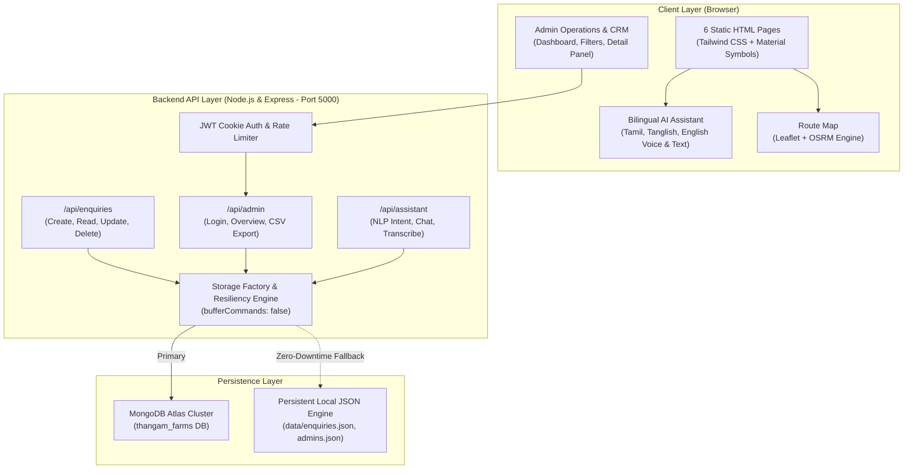

# STP CHICKENS by Thangam Farms — Master Platform Architecture

### Architectural Principles:
1. **Factual Integrity:** Core business facts (50 kg MOQ, 04:00 AM–06:30 AM dispatch, 2-hour callback) are strictly maintained in both frontend copy and backend knowledge bases.
2. **Graceful Degradation:** The backend dynamically checks MongoDB connection state and falls back to disk-persisted local storage without throwing buffering timeouts.
3. **Stateless Authentication:** Admin sessions utilize HTTP-only signed JWT cookies with strict expiration and CSRF/XSS mitigations.

